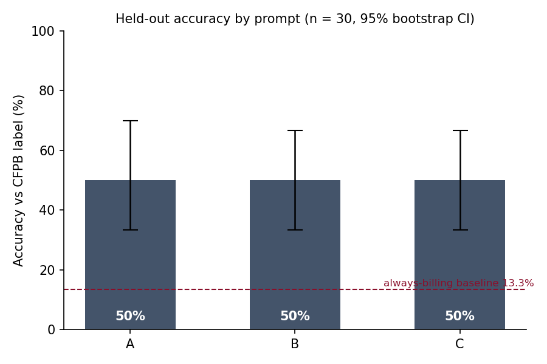
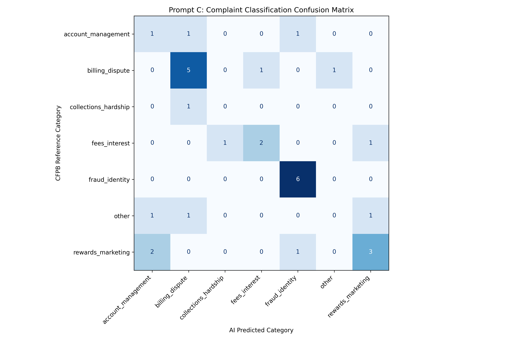
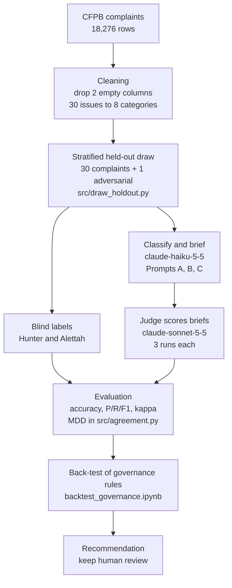

# CFPB Credit Card Complaints: AI Classification and Governance

*Classification results, written summary and governance memo*

<p align="center">


</p>

<p align="center">


</p>

**Alettah Mandigo and Hunter Case**

INFO 4340 - AI and Analytics

Fall 2026

University of Denver, Daniels College of Business

## Project Technology Stack

<p align="center">


</p>


> [!TIP]
> **Start here:** open [notebooks/final_project.ipynb](notebooks/final_project.ipynb) and the [back-test](notebooks/backtest_governance.ipynb). Both run offline from the saved outputs.

> [!IMPORTANT]
> The AI is not ready to route complaints on its own. Accuracy is 50% on our held-out set, and every number below comes with its uncertainty.

**Contents:** [Overview](#overview) · [Key Findings](#key-findings) · [Data](#data) · [Workflow](#workflow) · [Repo Contents](#repo-contents) · [How to Run it](#how-to-run-it) · [Limitations](#limitations) · [AI Use](#ai-use)

## Overview

Reading consumer complaints one at a time is slow and costly. This project asks how accurately Claude can sort credit card complaints from the CFPB database into eight categories, and whether the management briefs it writes can support business decisions. Claude Haiku 5.5 labels each complaint and drafts a brief per batch, while Claude Sonnet 5.5 and two human raters score the briefs. The governance memo turns the results into operating rules, with thresholds tested on our data.

## Key Findings

### Headline numbers

| Measure | Result | What it means |
|---|---|---|
| Accuracy vs CFPB label (held-out, n = 30) | **50%** (CI 33% to 67%) | Same for all three prompts; baseline 13.3% |
| Prompt C macro F1 | **0.465** | Across the eight categories |
| Blind classification kappa (two raters) | **0.272** | Fair agreement, 11 of 30 matched |
| Rubric kappa (two raters) | **0.651** | Above our 0.60 threshold |
| Brief score, Prompt C vs A and B | **19.5 vs 13.0** | Gap of 6.5 points, MDD is 2.14 |
| Judge vs human mean kappa | **0.544** | Below our 0.60 threshold |
| Token cost per complaint | **629 (C) / 484 (A)** | One 31-complaint run |

- **Classification accuracy is 50% on a held-out set of 30 complaints** (15 of 30 correct; 95% bootstrap CI 33% to 67%). All three prompts (A, B, C) scored the same. The majority-category baseline scores 13.3%. Prompt C's macro F1 is 0.465 across the eight categories (summary table in `final_project.ipynb`, cell 29).
- **Human raters agree only fairly on categories:** blind classification kappa is 0.272 (11 of 30 complaints matched). Rubric scores agree better, with linearly weighted kappa of 0.651.
- **Prompt C writes the best briefs:** it scores 19.5 of 20 on the rubric by the human raters, against 13.0 for A and B. The gap of 6.5 points is larger than the minimum detectable difference (MDD) of 2.14.
- **The AI judge agrees with the human mean at kappa 0.544,** which is below our 0.60 threshold, so the judge should not sign off alone.
- **Cost:** one 31-complaint run uses about 19,500 tokens for Prompt C and about 15,000 for Prompt A (about 629 and 484 tokens per complaint).

<p align="center">

<table>
<tr>
<td align="center"></td>
<td align="center"></td>
</tr>
</table>

</p>

> [!NOTE]
> The left chart shows each prompt's accuracy with a 95% bootstrap interval. The right chart shows where Prompt C's 15 errors fall.

## Data

- **Source:** [CFPB Consumer Complaint Database](https://www.consumerfinance.gov/data-research/consumer-complaints/), credit card complaints with narratives, 2015 to 2017.
- **Size:** 18,276 complaints, 18 columns (16 after removing two empty columns).
- **Unit of observation:** one consumer complaint, identified by Complaint ID.
- **Access:** included in `data/raw/`. The held-out evaluation files are in `data/processed/holdout/`.

## Workflow

1. **Cleaning:** removed two empty columns and checked for duplicate IDs (none). Mapped the 30 CFPB issue labels to eight categories so the classification task is manageable.
2. **AI step:** `claude-haiku-5-5` with max_tokens 16,000 and default sampling (current Claude models do not expose temperature). Three prompts (A, B, C) that differ in how much definition and structure they give the model. Judge: `claude-sonnet-5-5`, which scores each brief on five criteria (grounding, recurring issues, actionability, clarity, transparency; 0 to 4 each).
3. **Analysis:** per-category precision, recall and F1; accuracy with bootstrap CIs; Cohen's kappa; MDD; judge sensitivity over three runs.
4. **Evaluation:** a stratified held-out set of 30 complaints (at least three per category, fixed seed), plus one adversarial complaint with an embedded instruction. Two raters labeled and scored blind, and CFPB labels serve as the reference.
5. **Recommendation:** keep a person in the loop. Do not route complaints automatically until audit accuracy reaches 80% and blind kappa reaches 0.60. See the governance memo for the full set of rules.



## Repo Contents

```
CFPB-FINAL-PROJECT/
├── README.md
├── requirements.txt
├── .gitignore
├── data/
│   ├── raw/            # original CFPB file, untouched
│   └── processed/      # cleaned data and saved AI outputs
│       ├── cases.csv   # Week 7 sample (30 + adversarial)
│       ├── generation_results.json  # Week 7 prompt outputs
│       └── holdout/    # held-out set, labels, AI outputs, judge results
├── notebooks/
│   ├── final_project.ipynb         # main analysis, runs top to bottom
│   ├── backtest_governance.ipynb   # back-test of the governance rules
│   └── backtest_governance.html    # rendered back-test
├── src/                # helper functions and assets
│   ├── agreement.py    # MDD and classification kappa
│   ├── draw_holdout.py # draws the stratified held-out sample
│   └── plot_accuracy.py # accuracy chart with bootstrap CIs
├── docs/               # memo, written summary draft, EDA findings
└── outputs/            # figures and tables the notebook creates
```

## How to Run it

<details open>
<summary><b>Step by step</b></summary>

1. Clone this repo and install packages:
   `pip install -r requirements.txt`
2. (Only needed to re-run the AI step) Set your API key as an environment variable named `ANTHROPIC_API_KEY`.
3. Open `notebooks/final_project.ipynb` and run all cells. By default the notebook reads saved AI outputs from `data/processed/` and does not call the API.
4. To run the back-test, open `notebooks/backtest_governance.ipynb` and run all cells from the `notebooks/` folder. It reads the same saved outputs and also makes no API calls.

</details>

> [!TIP]
> Both notebooks run offline. You only need an API key if you want to regenerate the AI outputs.

## Limitations

> [!WARNING]
> These results describe one 30-complaint sample. Treat them as a first estimate, not a precise rate.

- The held-out sample is 30 complaints. Accuracy confidence intervals are wide (about 33% to 67%), so the numbers are a first estimate, not a precise rate.
- Prompt C was compared with A and B on the same 30 complaints, and the back-test thresholds were set after seeing those results. Those results are in-sample and probably optimistic.
- Blind classification kappa of 0.272 means the eight-category scheme is not reliable enough for unattended automation, even between trained people.
- The brief check counts only table and bullet counts. Counts written in prose are not checked.
- CFPB narratives are redacted and cover 2015 to 2017 only. There is no demographic data, so fairness can only be checked by category.
- Model versions change over time. Results apply to the specific model IDs listed above as of November 2026.

## AI Use

We used Claude to draft and debug code and to draft written sections, and we checked every number against the saved outputs. Our full AI use logs are submitted on Canvas.
